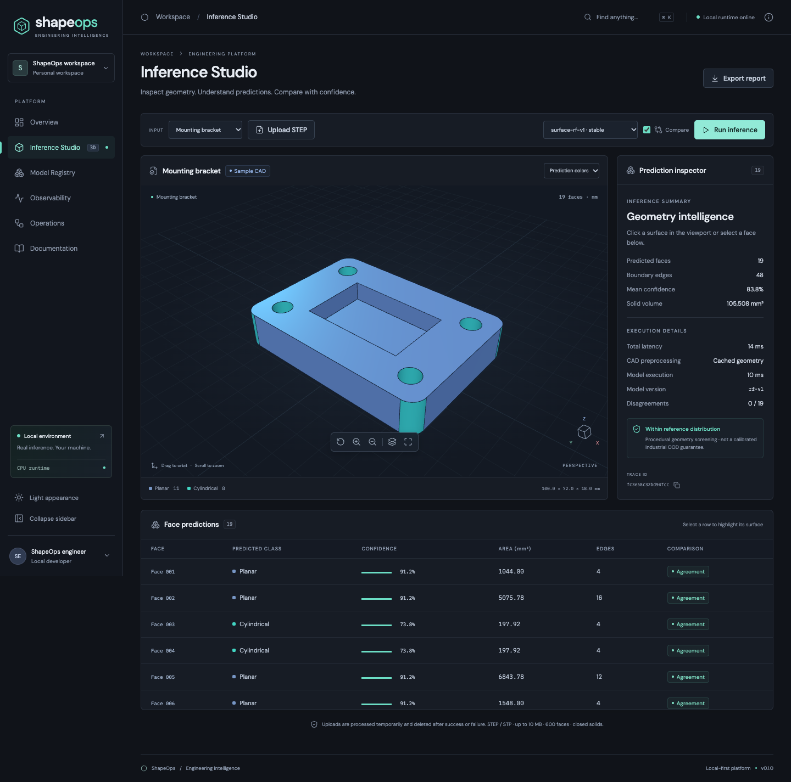
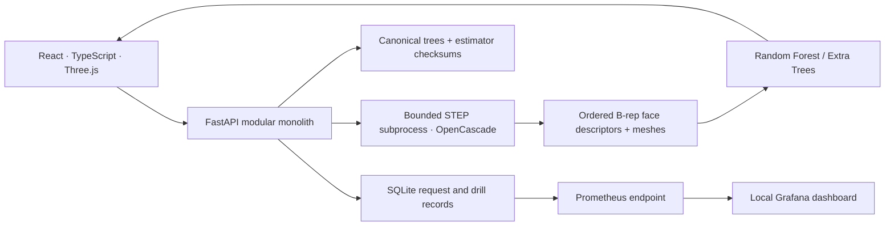
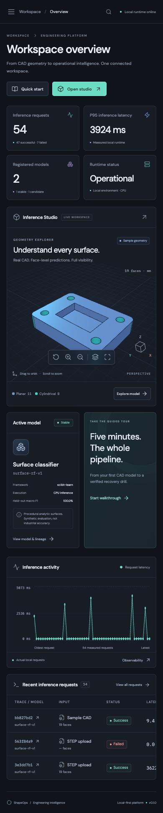

# ShapeOps

**CAD inference with an operational paper trail.**

ShapeOps is a local-first engineering platform for real STEP geometry, face-level model inference, interactive inspection, artifact lineage and actual runtime telemetry. Its six screens are Overview, Inference Studio, Model Registry, Observability, Operations and Documentation.



## Explore in five minutes

1. Open Inference Studio and orbit the original mounting bracket. Click a surface or select a face in the table.
2. Choose one of five sample solids or upload your own `.step` / `.stp` closed solid. Original samples are also downloadable as real STEP files.
3. Run a trained model, enable comparison, inspect disagreements and export the actual inference report.
4. Open Model Registry to inspect model cards, checksums, synthetic evaluation and release gates.
5. Find the real request in Observability, then execute an isolated failure/recovery test in Operations.

The in-app Documentation screen includes the full timed walkthrough and interactive API reference.

## Run locally

Requires Node.js 22+ and Python 3.14 with compatible native CAD wheels.

```bash
python3 -m venv .venv
.venv/bin/pip install -r requirements.txt
npm ci
./scripts/dev.sh
```

Open **http://127.0.0.1:5173**. The API is at **http://127.0.0.1:8000**, with Swagger UI at `/docs`. Initial API startup builds the seeded classifiers and sample meshes; wait for `Application startup complete`. No Azure credentials are required.

For a single-process build:

```bash
npm run build
.venv/bin/uvicorn backend.app:app --host 127.0.0.1 --port 8000
```

Docker preparation: `docker compose up --build`. Optional local monitoring: `docker compose --profile monitoring up --build`. Docker execution has not been verified on the current workstation; see the acceptance record.

## Architecture



**Stack:** React 19, Vite 7, TypeScript, Three.js, FastAPI, CadQuery/OpenCascade, scikit-learn, SQLite, Prometheus/Grafana configuration, Docker, Helm/Kind configuration, Terraform/Azure configuration, GitHub Actions.

## What is real

- STEP parsing, topology validation and tessellation use OpenCascade. The same face index connects mesh selection, numerical descriptors and prediction rows.
- Models are genuinely trained, distinct estimators. Inputs include numerical curvature samples, curvature variation, area and edge count. CAD surface-type labels are targets, never input features.
- Two versions have separate tree and packaged-estimator checksums. The reproducible parameter-group holdout uses original procedural geometry, not private or research datasets.
- Dashboard counts, latencies, model probabilities, OOD flags and request traces come from executed requests. Sample inputs are labeled. No production traffic is simulated.
- Incident drills inject an isolated adapter failure and execute real stable-model recovery inference. They do not deploy, mutate production, or demonstrate cloud revision rollback.

## Evidence and boundaries

Verified locally: **15 backend tests**, **3 browser tests** (desktop, mobile, and WCAG checks across all six screens in both themes), TypeScript production build, Ruff checks, MyPy baseline checks, Helm lint/render, Terraform formatting/provider-schema validation. Runtime dependency audits found no known vulnerabilities at audit time. Screenshots were captured in real Chromium and visually inspected; no layout-wide horizontal overflow was detected at 390px.

The bounded ten-request local cached-sample benchmark measured approximately **20.9 ms median client latency** under the recorded workstation conditions. This excludes STEP parsing, cold startup and cloud networking. See [raw benchmark](artifacts/benchmark.json), [backend test/resource record](artifacts/backend-tests.txt), [accessibility audit](artifacts/accessibility-audit.json), [Python audit](artifacts/python-audit.json) and [npm runtime audit](artifacts/npm-audit.json). No cloud performance or uptime is claimed. Hosted CI results must be checked on GitHub; local passes are not a claim of hosted CI success.

**This is a working local baseline, not a completed production deployment.** The classifier predicts analytic surface classes, not manufacturing features. Confidence is uncalibrated. Held-out synthetic scores do not establish industrial generalization. OOD screening uses a deliberately small procedural reference. BRepNet and Fusion Gallery assets are not bundled; see [research decision](docs/model-research.md).

Uploads are capped at 10 MB, 600 faces and 30 seconds of parsing. Temporary files are deleted on success or failure. Public promotion is disabled. Additional worker memory isolation, distributed abuse controls, authenticated administration and durable cloud adapters are required before public production.

Docker/Kind execution, image scans, Azure plans, production deployment, domain registration, durable cloud storage and live revision rollback remain unverified or unimplemented. No Azure infrastructure has been provisioned. `shapeops.dev` is proposed and unverified. See [open issues](docs/open-issues.md) and [Azure readiness](docs/azure-readiness.md).



## Engineering guides

- [Product specification](docs/product-specification.md) · [Architecture and decisions](docs/architecture.md)
- [Model methodology and governance](docs/models.md) · [Security threat model](docs/security.md)
- [Developer and testing guide](docs/development.md) · [Operations runbook](docs/operations.md)
- [Azure/Terraform readiness](docs/azure-readiness.md) · [Requirements matrix](docs/requirements-matrix.md)
- [Progress](docs/progress.md) · [Roadmap](docs/roadmap.md) · [Session handoff](docs/session-handoff.md)

Original application code and procedural geometry use the MIT license. Third-party libraries retain their own licenses. ShapeOps uses an original identity and has no Autodesk affiliation.
