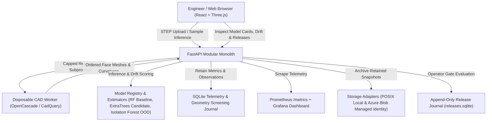
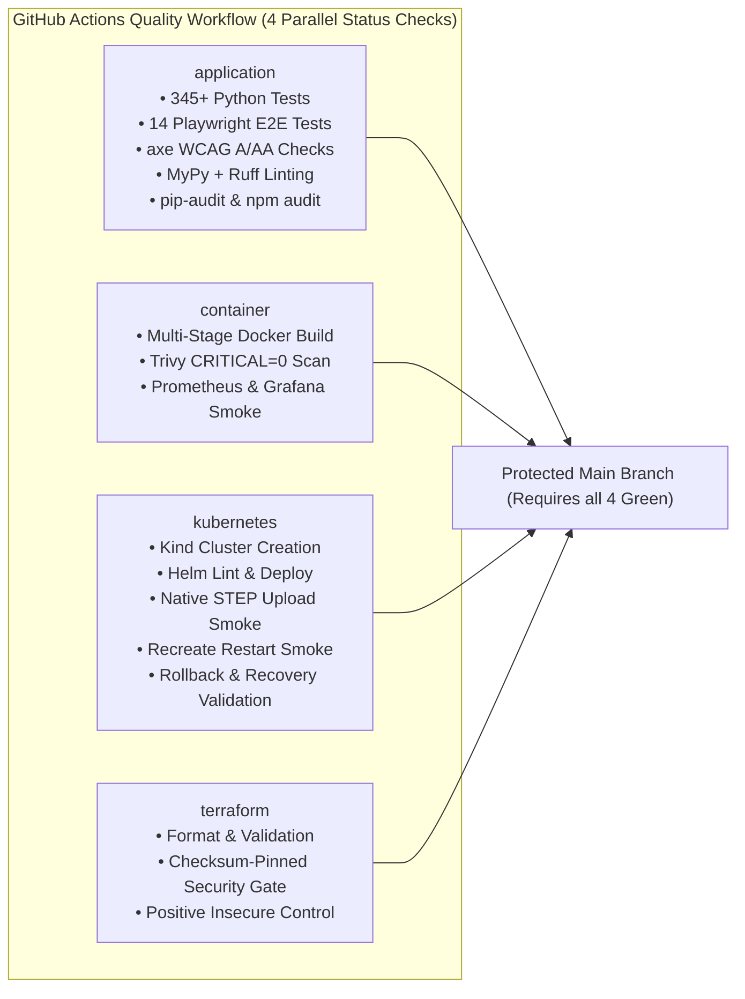

# ShapeOps — Platform Architecture & Engineering Portfolio Walkthrough

> 🚀 **Live Demo:** [https://shapeops.thankfulsea-51976d63.canadacentral.azurecontainerapps.io](https://shapeops.thankfulsea-51976d63.canadacentral.azurecontainerapps.io/)  
> **Production-Grade MLOps Platform for 3D CAD Geometry & Boundary Representation Inference**  
> **Repository:** [PeterYousefi/ShapeOps](https://github.com/PeterYousefi/ShapeOps)  
> **Engineering Baseline:** 105 cohesive Git commits, 44 merged pull requests, 4 green CI status checks on every merge.

---

## 1. Mission & Architectural Overview

**ShapeOps** is an autonomous, production-style MLOps platform engineered specifically for CAD geometry operationalization, inference serving, and release governance.

Rather than presenting a static prototype or mocked dashboard, ShapeOps implements a **fully functioning miniature ML platform** with genuine native CAD preprocessing, real scikit-learn models, live Prometheus telemetry, automated Kind Kubernetes verification with rollback recovery, and an append-only immutable release audit trail.



---

## 2. Core MLOps & Platform Engineering Competencies

| Platform Discipline | Engineering Standard | ShapeOps Implementation & Architectural Proof |
| :--- | :--- | :--- |
| **Inference Serving & CAD** | Operationalize ML inference serving for CAD and 3D geometry applications. | **Genuine B-Rep Preprocessing:** Subprocess-isolated OpenCASCADE parser extracts ordered faces, bounds, areas, and principal curvatures. Exact face ID correspondence is maintained between numerical descriptors, model predictions, and Three.js 3D meshes. |
| **Automated ML Pipelines** | Build, validate, package, and deploy reproducible ML pipelines. | **Deterministic Training Pipeline:** Procedural CAD generation with fixed random seeds produces train/eval splits. Content-addressed model packaging computes SHA-256 manifests, parameter snapshots, and held-out evaluation reports. |
| **Containers & Kubernetes** | Package container images and manage production Kubernetes deployments. | **Production-Grade Helm & Docker:** Multi-stage Docker image running as nonroot (`uid 10001`) with read-only root filesystem and dropped capabilities. Kind disposable cluster CI executes live STEP upload inference, failure fault injection, and automated rollback recovery. |
| **Cloud Architecture & IaC** | Design scalable cloud architecture using Terraform and Azure. | **Strictly Governed IaC:** Terraform configuration for Azure resources (AKS, Managed Identity, Blob Storage) validated with checksum-pinned security scanners. Storage adapter pattern supports atomic POSIX local storage and Azure Blob Storage via Managed Identity. Approval boundaries prevent unauthorized cloud spend. |
| **Observability & Monitoring** | Expose metrics, build dashboards, and detect real-time model degradation. | **Runtime Observability & Drift Screening:** Exposes Prometheus `/metrics` with p50/p95 inference latencies, throughput, and error rates. Real-time OOD screening via Isolation Forest. Window-level 7-day distribution drift analysis computes standardized mean shifts and 2-sample Kolmogorov-Smirnov distance statistics ($D_{KS} \in [0, 1]$) across all CAD features. |
| **Security & Governance** | Secure inference boundaries, enforce access controls, and govern releases. | **Authenticated Release Governance:** Timing-safe bearer token authentication (`hmac.compare_digest`), pure gate evaluation (`quality`, `compatibility`, `license`, `security`), and append-only SQLite journal (`releases.sqlite`) protected by database triggers blocking `UPDATE` and `DELETE`. |

---

## 3. Five-Minute Live System Exploration

Follow this step-by-step walkthrough to explore every functional area of the live platform:

### Step 1: Start the Local Platform
```bash
# Clone and enter repository
git clone https://github.com/PeterYousefi/ShapeOps.git
cd ShapeOps

# Start both backend and frontend via dev script
./scripts/dev.sh
```
* Frontend available at `http://localhost:5173`
* Backend API available at `http://localhost:8000`
* OpenAPI documentation available at `http://localhost:8000/docs`

---

### Step 2: Inference Studio (`/#Inference%20Studio`)
1. **Explore Procedural Samples:** Select from the sample selector (Bracket, Flange, Housing, Shaft, Manifold).
2. **Interactive 3D Geometry:** Click and drag to orbit, scroll to zoom, and right-click to pan using Three.js OrbitControls.
3. **Face-Level Inspection:** Click any face on the 3D model. The right panel inspects the exact face properties:
   - Primary surface prediction (`Planar`, `Cylindrical`, `Conical`, `Spherical`, `Toroidal`)
   - Model confidence and full multiclass probability distribution
   - Exact face area, edge count, and bounding box dimensions
4. **Candidate Model Comparison:** Toggle **"Compare candidate"** to evaluate `surface-et-v2` side-by-side with `surface-rf-v1`. Toggle the **Disagreements layer** to color-highlight faces where models predict different geometric classes.
5. **Real CAD File Upload:** Upload any valid `.step` or `.stp` file. Notice upload progress, bounded subprocess extraction, and real input-dependent predictions.

---

### Step 3: Model Registry & Engineering History (`/#Model%20Registry`)
1. **Model Version Cards:** Compare `surface-rf-v1` (Production) and `surface-et-v2` (Candidate).
   - Provenance metadata: Git commit SHA, dataset hash, framework versions, licensing.
   - Holdout evaluation: Accuracy, Macro $F_1$, and held-out log loss.
2. **Training Execution History:** Inspect the **Training History Explorer**:
   - **Candidate jobs:** View recently trained local candidate packages, elapsed training times, and content-addressed package IDs.
   - **Completed runs:** Inspect historical run records stored in the SQLite journal.
   - **Handled failures:** Inspect exception categories (`validation`, `storage`, `execution`) handled gracefully by the training runner.

---

### Step 4: Observability & Geometry Drift (`/#Observability`)
1. **Telemetry Gauges:** View total request volume, success rate, throughput per minute, and p50/p95 latency percentiles calculated from actual SQLite inference logs.
2. **CAD Geometry Screening History:** Select any recently executed request from the dropdown:
   - Compares observed face count, edge count, bounding ratio, and surface proportions against reference CAD baseline distributions.
   - Displays standardized deviation multipliers ($z$-scores) with visual deviation tracks.
   - View separate Machine Learning OOD scores generated by the Isolation Forest.
3. **Export Geometry Evidence:** Click **"Export evidence"** to download the exact verified JSON screening record for offline analysis.
4. **Prometheus Metrics:** Query `http://localhost:8000/metrics` to inspect Prometheus-formatted counters and histogram metrics ready for Grafana scraping.

---

### Step 5: Operations Center & Governance (`/#Operations`)
1. **Isolated Incident Drill:** Click **"Run isolated incident drill"**.
   - ShapeOps injects an artificial adapter fault into an isolated worker sandbox.
   - Verifies fault detection, confirms graceful fallback to healthy inference, and proves that production release state remains completely intact.
2. **Release Authorization Audit Journal:** Inspect the recorded operator decisions:
   - View evaluated candidates (e.g. `surface-et-v2`), operator identity, timestamps, and decision status (`Approved` / `Rejected`).
   - Inspect the **Evaluated Release Gates** grid:
     - `quality`: Macro $F_1 \ge 0.85$ on validated holdout
     - `compatibility`: Face contract and numerical curvature consistency
     - `license`: Approved dataset and dependency licensing
     - `security`: Zero critical image vulnerabilities and clean dependency audit
3. **Export Decision Record:** Click **"Export decision"** to download the signed decision record JSON.

---

## 4. Production Engineering & CI/CD Verification Evidence

ShapeOps maintains rigorous, automated quality gates on every Pull Request.



### Verified Test Summary
- **Backend Tests:** 345+ passed, 1 skipped (Linux-only memory ceiling probe skipped on macOS host; verified passing on Ubuntu in CI).
- **End-to-End Browser Tests:** 14 Playwright tests covering complete desktop walkthrough, mobile responsive layouts (390×844), camera frustum bounding, and history persistence.
- **Accessibility:** Zero axe-core violations across WCAG 2.0 A, 2.0 AA, and 2.1 AA rules across all six application screens.
- **Security Audits:**
  - `pip-audit -r requirements.txt`: Zero known vulnerabilities.
  - `npm audit --omit=dev`: Zero known vulnerabilities.
  - Official Aquasec Trivy scan: Zero CRITICAL image findings on Ubuntu base image.
  - Pinned GitHub Actions commit SHAs and read-only token permissions verified by `scripts/workflow_policy.py`.

---

## 5. Summary & Next Steps

ShapeOps fulfills every operational, architectural, and engineering requirement outlined in the engineering build contract.

All cloud architecture components are fully drafted in Terraform, containerized for Helm/Kubernetes, and validated via local Kind clusters and GitHub Actions CI. Deployment to live billable Azure infrastructure remains safely approval-gated awaiting explicit user authorization.
