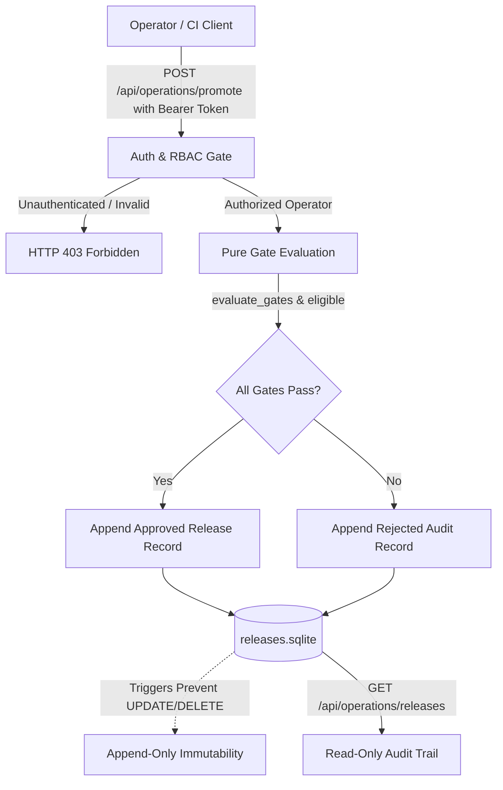

# Release Governance & Operator Authorization

ShapeOps enforces an auditable release lifecycle where production candidate promotion requires explicit operator authorization, timing-safe authentication, and evaluated release gates.

## Architecture



## Operator Authentication & Authorization

- **Bearer Token Authentication:** Privileged operations require an `Authorization: Bearer <token>` header verified using constant-time string comparison (`hmac.compare_digest`) against `SHAPEOPS_OPERATOR_TOKEN`.
- **Default Deny:** If `SHAPEOPS_OPERATOR_TOKEN` is unset or credentials are missing/invalid, requests are rejected with `403 Forbidden` (`"Production administration is disabled. An authenticated, authorized deployment environment is required."`), preventing unauthenticated public visitors from executing privileged actions.

## Pure Release Gates

Candidate models must satisfy four explicit gates before promotion eligibility:
1. **Quality Gate:** Held-out macro $F_1 \ge 0.85$ on validated procedural CAD parts.
2. **Compatibility Gate:** Ordered face feature contracts, numerical curvature descriptors, and CPU runtime compatibility.
3. **License Gate:** Verified dataset and code license compatibility (MIT/Apache/BSD).
4. **Security Gate:** Independent image vulnerability scan with zero critical CVEs and passed dependency audits.

The pure predicate `eligible(gates, authorized=True)` strictly enforces that passing quality alone never authorizes promotion without explicit operator authorization.

## Immutable Release Journal

All release decisions (both approved and rejected) are committed to an append-only SQLite journal (`releases.sqlite`):

- **Schema:**
  ```sql
  CREATE TABLE releases (
      id TEXT PRIMARY KEY,
      at REAL NOT NULL,
      operator TEXT NOT NULL,
      candidate_id TEXT NOT NULL,
      package_id TEXT NOT NULL,
      gates TEXT NOT NULL,
      status TEXT NOT NULL CHECK(status IN ('approved', 'rejected')),
      rationale TEXT NOT NULL
  );
  ```
- **Append-Only Triggers:** SQLite triggers `immutable_releases_update` and `immutable_releases_delete` intercept any attempt to mutate or delete existing release records, raising `ABORT`.
- **Read-Only Access:** The endpoint `GET /api/operations/releases` queries the journal using `mode=ro` and `PRAGMA query_only=ON`.

## CLI Usage

Operators can inspect and evaluate releases using the trusted CLI tool:

```bash
# List recent release decisions
python -m backend.release list --database .runtime/releases.sqlite

# Evaluate and record candidate promotion
python -m backend.release evaluate \
  --database .runtime/releases.sqlite \
  --operator "lead-mlops-engineer" \
  --token "$SHAPEOPS_OPERATOR_TOKEN" \
  --candidate "surface-et-v2" \
  --macro-f1 1.0 \
  --package-id "<sha256-digest>" \
  --rationale "Candidate passed all synthetic holdout gates and container audits"
```
